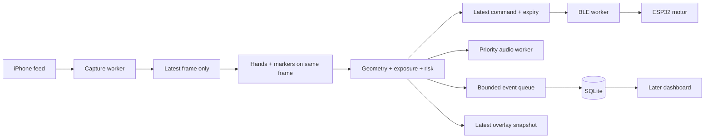

# ArmGuard PD: software and feedback design

Status: implementation plan, reconciled November 7, 2026. Only the original ESP32
firmware exists in this repository; neither the native iPhone application nor
the earlier Mac application below is implemented or benchmarked.

The updated [ArmGuard PD product design](<ArmGuard PD Real-Time Sterile Technique Coaching for Home Peritoneal Dialysis.md>)
sets the product direction. The current preferred implementation runs capture,
tracking, risk, BLE and audio on the iPhone. The native plan below supersedes the
earlier Mac-primary execution/stack sections, which are retained as alternatives.
Prop geometry, exposure rules and bench-validation requirements apply to either
implementation. [README.md](README.md) documents existing firmware and wiring.

## Scope and reconciliation

There are two programs:

1. **Native iPhone app:** capture RGB/depth, locate protected surfaces and nearby
   hazards, estimate risk, transmit vibration intensity directly to the band,
   and speak a relevant prompt. A Mac is for development and optional later logs.
2. **ESP32:** receive commands and drive the motor. Vision and rules stay on phone.

Current work focuses on the first program. Its central rule is **protect an
exposed sterile surface from an inappropriate collision**, whether the hand or
connector is moving. Entering a tray zone is supporting evidence, not proof of an
exchange step or contamination. The table records the earlier Mac design
reconciliation; see the native implementation decision immediately below it.

| Topic | Earlier DESIGN / README | Updated product design | Implementation decision |
| --- | --- | --- | --- |
| Camera | Overhead USB webcam | iPhone Continuity Camera on Mac | iPhone primary; USB webcam as a measured fallback |
| Target | Hands in fixed tray zones | Fingertips near moving sterile tips | Track protected surfaces on props; retain fixed zones for visible environmental hazards |
| Sequence | Sanitizer / supplies / connector | Connect and disconnect phases | Manual phase/exposure controls first; hand presence does not verify washing or connection |
| Contact | Entering a forbidden zone | 0.8 cm radius for three frames | Report projected proximity / suspected contact; monocular overlap cannot confirm touch |
| Geometry | Clicked image regions | Marker offset and averaged pixels/cm | Calibrated planar geometry for constrained demo; calibrated marker pose for tilted props, with hand-depth limits |
| Model | MediaPipe, unspecified API | Legacy Hands with model complexity 0 | MediaPipe Tasks Hand Landmarker; legacy options are not Tasks options |
| Band | Wristband, fixed patterns | Upper-arm band, variable intensity | Neutral band interface; mounting is a hardware/usability decision |
| BLE | DialysisBand, ASCII commands | ArmGuard-L/R, binary commands | Adafruit motor supports PWM intensity; add intensity reception/PWM to the existing fixed-pattern firmware |
| Timing | No budget | Under 150 ms, contact debounce | Warn immediately on usable risk; event confirmation must not delay warning |
| Tracking loss | Unspecified | No buzz after 300 ms | Protection unavailable, distinct pause prompt, expire commands; missing detection is not clearance |
| Dashboard | Future | Scores, clips, patient ranking | After the live loop works; keep outside the decision path |

The product document's clinical sequence, infection-reduction claims and scoring
weights require validation. Geometry does not establish sterility or prove a
clean exchange.

## Preferred implementation: native iPhone, no live computer link

The user proposes building the app and running inference locally. Adopt this
direction for the next implementation, targeting an iPhone 15 Pro if available.
Its rear LiDAR/main-camera combination is a capture candidate, not evidence of
contact-detection accuracy. The standard iPhone 16 can separately test front
TrueDepth; do not silently substitute RGB-only operation for validated depth.

```text
iPhone RGB + depth
  → on-device hand and prop observations
  → registered geometry + exposure/risk rules
  → CoreBluetooth → ESP32 → PWM vibration
  → phone speaker + local event log

Mac: build/install/debug; optional later event export or dashboard
```

This removes RGB/depth encoding, transport and host decoding from the live loop.
It does not establish a latency result: measure phone inference, depth validity,
BLE, motor onset and sustained thermal performance on the actual device. No
Record3D purchase, server, Apple-hosted inference or live Mac receiver is required
for this architecture.

| Layer | Native choice | Design consequence |
| --- | --- | --- |
| App/UI | Swift + SwiftUI, native camera preview/overlay | One foreground screen with readiness, arm/stop, calibration and manual phase controls |
| RGB/depth | AVFoundation video/depth outputs and AVCaptureDataOutputSynchronizer | Process paired frames with timestamps and calibration; begin from Apple's capture sample |
| Hand model | Vision VNDetectHumanHandPoseRequest, maximumHandCount=2 | Built-in hand-pose detection; no custom training or Python runtime; validate this detector rather than assuming MediaPipe results transfer |
| Prop markers | Keep ArUco via OpenCV iOS and a thin Objective-C++ bridge | Preserve existing marker IDs and measured prop profiles; native integration is work but requires no model training |
| Marker simplification, optional | Native Vision QR detection on rigid flags | Alternative if avoiding OpenCV is important; requires different printed tags and validated corner/pose handling, not an ArUco-compatible drop-in |
| Coordinates/risk | Swift geometry with calibrated depth and marker transforms | Same boundary-clearance, exposure, uncertainty, loss and review semantics as this document |
| Band | CoreBluetooth central directly to ESP32 characteristic | Preserve explicit legacy versus intensity-v2 modes, freshness, heartbeat and watchdog contract |
| Audio | AVAudioPlayer preloaded clips; AVSpeechSynthesizer development fallback | Priority/cooldown worker; speech must not block vision |
| Log | Small local Codable event records on a background writer | Export summaries later; no dashboard/network dependency for alerts |

Apple documents [hand-pose detection](https://developer.apple.com/documentation/vision/vndetecthumanhandposerequest),
[synchronized LiDAR capture](https://developer.apple.com/documentation/avfoundation/capturing-depth-using-the-lidar-camera),
and [BLE central communication](https://developer.apple.com/library/archive/documentation/NetworkingInternetWeb/Conceptual/CoreBluetooth_concepts/PerformingCommonCentralRoleTasks/PerformingCommonCentralRoleTasks.html).
Vision hand joints are image observations, not automatically metric 3D coordinates.
Register RGB, depth and marker geometry into a common coordinate space. Reject
invalid/edge-mixed/background depth samples rather than treating them as safe.

Use a latest-only synchronized frame slot and one inference worker, with UI, BLE,
audio and disk I/O scheduled independently. Initial capture target is 30 fps;
infer as quickly as validated, discarding backlog. Keep depth filtering under
measurement because smoothing can add delay at moving boundaries. Log capture
presentation times, inference time, decision age and output dispatch. Camera
permission, Bluetooth permission/state and required calibration are explicit
readiness gates. No microphone permission is required merely to speak a prompt.

The first app is foreground-only. Keep it awake while explicitly armed; on
backgrounding, capture interruption or loss of valid observations, disarm, clear
pending intensity, send OFF if possible and retain review flags. On resume require
readiness/rearming. Do not assume background Bluetooth keeps camera tracking alive.

### Development install on the teammate's phone

The user confirmed the phone and development Mac will be together. Use **direct
Xcode installation by cable**:

1. Install full Xcode with an iOS SDK/device support compatible with the phone's
   installed iOS. This workspace currently has only Command Line Tools selected;
   no Xcode app was found in the usual application folders. An iOS build and
   hardware validation cannot be performed with that setup alone.
2. Open the project, sign into an Apple Account in Xcode and select the appropriate
   team with automatic signing and a unique bundle identifier. The account owner
   completes account authentication locally.
3. Connect/unlock the phone, trust/pair it with the Mac and select it as the run
   destination. Enable Developer Mode when prompted; this includes a restart and
   confirmation by the phone owner.
4. Build and run. Grant camera/Bluetooth access. Verify actual capture, marker
   geometry and the selected BLE protocol before enabling warnings.
5. Disconnect the development cable and verify standalone operation. Rebuild and
   reinstall when the development provisioning profile expires.

A free Personal Team supports local testing; its provisioning profiles expire
after seven days. This does not require buying a Developer Program membership
for the local prototype. See Apple's [account/signing limits](https://developer.apple.com/help/account/basics/about-your-developer-account)
and [Developer Mode instructions](https://developer.apple.com/documentation/xcode/enabling-developer-mode-on-a-device).
Do not describe sending an arbitrary unsigned app file as a working iPhone install.

If the phone is remote, either send the source/project to someone with Xcode who
can sign and install locally, or use an established signed distribution route.
TestFlight requires Developer Program access; Apple's listed membership is
[$99 USD/year](https://developer.apple.com/programs/). External testing includes
a first-build review step; see [TestFlight distribution](https://developer.apple.com/help/app-store-connect/test-a-beta-version/testflight-overview/).
Use direct installation when available rather than depending on that review for
an imminent demo. No time estimate assumes successful signing or existing Xcode.

### Complexity and implementation sequence

Installation is a contained setup task when the phone and development Mac are
together. The difficult engineering is reliable geometry/depth at moving finger
boundaries, occlusion handling, and end-to-end timing. On-device execution avoids
building a streaming protocol but adds native capture, UI and app lifecycle work.

1. Establish a signed empty app on the actual phone, then verify RGB/depth capture.
2. Add Vision hands and a debug depth display; measure hovering separation and
   invalid depth at the intended working distance before promising contact precision.
3. Add marker registration and the shared risk state machine; display numeric risk
   with mock output, including safe grip and loss cases.
4. Add audio and direct BLE legacy commands; add intensity-v2 only with compatible
   firmware. Verify command expiry, app interruption and reconnect behavior.
5. Profile sustained operation and record physical warning-to-motor trials. Local
   logs and optional export follow; defer dashboard, clips and automatic step checks.

Suggested native modules: CaptureSession, HandTracker, MarkerTracker,
DepthRegistration, RiskEngine, BandClient, PromptPlayer, EventStore and a single
SessionViewModel. Implement pure Swift geometry/state tests and recorded-frame
replay; real camera/depth/BLE/motor tests need the device. These are proposed
modules, not files already present in this repository.

## First demo and collision coverage

Use mock connectors held near a calibrated horizontal working plane. Demonstrate:

1. Finger approaches an exposed tip: intensity rises; audio says “Move your hand
   away from the exposed tip.”
2. Moving exposed connector approaches a stationary hand: the same rule fires.
3. Exposed tip approaches a marked nonsterile patch: warn “Keep the exposed tip
   away from that surface.” This tests protection beyond fingertip tracking.
4. Hand retreats: warning clears with hysteresis and one near-miss is logged.
5. Projected overlap persists: log one **suspected contact**, speak a configured
   stop prompt and latch that prop for operator review/reset.
6. Marker is covered or camera stops: show **protection unavailable** and speak
   “Pause. Move the connector into view.”

The patch represents a nonsterile surface under the planar demo constraint, not a
verified floor strike. Leaving camera view means lost coverage, not proof of a
fall. Use independently labeled video as physical-contact ground truth.

Each prop has **safe grip geometry** and **protected surface geometry**: an exposed
end, opening or inner cap surface. Do not label the complete bag/tube exterior as
sterile. Use disks, capsules or polygons in the prop's local coordinates so the
protected surface follows its movement and rotation.

| Collision / condition | First-demo treatment | Evidence / limitation |
| --- | --- | --- |
| Exposed surface ↔ fingertip / finger pad | Implement | All five fingertips plus padded distal finger segments; overlap is a contact candidate |
| Exposed surface ↔ palm / back of hand | Conservative approximation | Padded palm polygon from hand landmarks; validate separately from fingertips |
| Exposed surface ↔ marked nonsterile patch / boundary | Implement projected warning | Fixed calibrated polygons; meaningful metric distance only near the working plane |
| Exposed surface ↔ another prop's nonsterile exterior | Next increment | Register geometry of both objects; test protected surface against exterior |
| Intended connector ↔ intended mating partner | Explicit exception | Allow only that configured pair in CONNECT with operator confirmation; retain hand protection |
| Covered connector / safe grip ↔ hand | Allowed by demo geometry | Gripping the body should not trigger the tip rule; does not validate clinical handling |
| Exposed surface ↔ sleeve, forearm, torso, hair | Later | Hand landmarks do not cover these; require validated additional detection/segmentation |
| Exposed surface ↔ floor | Later | Need a view covering the floor and calibrated geometry/depth or another sensor; disappearance is UNKNOWN |
| Droplets, dirty hands, package damage | Outside geometric MVP | Distance cannot establish these hazards |

The engine accepts geometry from any hazard detector rather than assuming every
hazard is a fingertip. For one band, transmit the maximum active risk across both
hands and all props. Two-band attribution comes later; uncertain hand identity
must remain visible.

### Exposure, phase and visibility

```text
COVERED --operator uncaps--> EXPOSED --operator confirms mating--> CONNECTED
                               |
                               +--suspected contact--> REVIEW_REQUIRED

Any state --observation invalid--> visibility UNKNOWN (underlying state retained)
REVIEW_REQUIRED --operator replaces/resets demo prop--> COVERED or EXPOSED
```

Visibility is independent of exposure. Losing a marker must not reset a contact
flag or imply a cap was fitted. Start with manual phase/exposure controls; camera
presence in a sanitizer region is not verified handwashing. Advancing phase alone
must not clear REVIEW_REQUIRED. Only an explicit operator action acknowledges
replacement/reset in this demo.

## Props and adapting the software

Prefer a PD training kit from a teaching program. Otherwise use clearly labeled
mock tubing/connectors with identifiable ends. Substitutes demonstrate the sensing
mechanism, not an accurate clinical exchange procedure.

| Item | Setup | Software adaptation |
| --- | --- | --- |
| Mac, compatible iPhone, USB cable | Stable overhead arm; start around 40–60 cm and check framing | Select actual camera each session; verify delivered resolution/freshness |
| Matte mat, even lamp | Work area around 40 × 30 cm as a starting layout | Define operating area; check motion blur and marker contrast |
| Mock transfer set and bag-line connector | Two rigid ends, tubing, height-controlled holders | Register IDs, marker-to-tip transforms, protected surfaces and safe grips |
| Mock cap on rigid carrier | One | Register its inner protected surface; manual exposure state |
| Printed ArUco tags on rigid flags | Unique IDs; initially 25–35 mm square if practical | DICT_4X4_50; measure black square excluding white margin; verify visibility in camera pixels |
| Reference board/grid and ruler | Known dimensions around work area | Lens calibration, plane mapping, drift detection, independent distance checks |
| Contrasting nonsterile patch | Fixed polygon on mat | Mark corners in calibrated coordinates; planar environmental hazard |
| Safe-grip sleeves/handles | One per connector | Keep fingers/tags visible without enlarging protected surface |
| Mock bag/container | Optional context | Whole-bag detection is unnecessary for first loop |
| Band, Mac speaker, optional serial cable | One band initially | Mock intensity, legacy commands, then intensity adapter after firmware update |
| Separate high-speed recording device | Borrow for measurement | Record physical zone crossing and band indicator/motor onset independently |

Put tags on flat rigid flags attached to the **nonsterile exterior**, away from
the grip/opening. Do not wrap tags around curved tubing. A tag on flexible tubing
does not define a fixed transform to a freely moving tip. Additional tags can
reduce occlusion if their transforms to the same rigid prop are registered. A
larger tag improves visibility; it does not enlarge the protected surface.

### Calibration and changing props

1. Fix camera mode, framing and mount. Disable automatic reframing/visual effects.
   Calibrate lens intrinsics/distortion with a calibration board; save camera,
   resolution and crop metadata.
2. Register the horizontal working plane in centimeters from reference points.
   Hold protected surfaces at that plane's height. Check distances across the
   usable area with a ruler.
3. Measure each marker's size, marker-to-surface transform, tip shape, safe grip,
   mating partner and initial exposure. Overlay the projected surface and check
   multiple positions and rotations against the real prop.
4. Test gaps of 0, 1, 2, 3 and 5 cm. Also deliberately lift a finger above the tip
   to expose 2D overlap ambiguity. Reject configurations that cannot resolve the demo.
5. Save a named prop profile and calibration ID. Swapping props means updating
   measured geometry and repeating these checks, not retraining a model.
6. Camera movement requires plane registration again; changes in optics/image
   mode require checking/replacing intrinsics. Reference markers detect drift
   and invalidate affected measurements.

In constrained planar mode, map marker corners and hand image points through the
calibrated plane transform, then apply the prop's planar transform. Do not average
pixel scales from markers at different heights. Departure from the working height
introduces parallax and invalidates metric hand-to-tip distances.

For tilted rigid props, estimate marker pose and transform protected geometry:
`p_camera = R_marker * p_local + t_marker`. Project this for an overlay / projected
warning. OpenCV documents calibrated marker pose via `solvePnP` and known marker
dimensions in its [ArUco guide](https://docs.opencv.org/4.x/d5/dae/tutorial_aruco_detection.html).
This supplies marker pose, not hand depth.

MediaPipe's hand-relative z and hand-centered world landmarks do not share the
marker's camera-space origin; do not subtract them directly from marker coordinates.
See the [Hand Landmarker coordinate definitions](https://developers.google.com/edge/mediapipe/solutions/vision/hand_landmarker?tab=Python).
Continuity Camera RGB is not calibrated hand depth. Free-space contact requires
validated depth/stereo or another calibrated view. An iPhone having LiDAR does not
itself make depth available to this capture pipeline.

### Available phone: standard iPhone 16

The user has an iPhone 16. It has rear main/ultra-wide cameras and front TrueDepth,
but no rear LiDAR. It supports spatial video at 1080p/30 fps; see Apple's
[iPhone 16 specifications](https://support.apple.com/en-us/121029). Spatial video
support is not proof of an accessible low-latency stereo stream through our
OpenCV/Continuity Camera path.

Before selecting a free-space depth implementation, run a **front TrueDepth
feasibility test**. Mount the phone with the front camera/screen facing the props.
Try an existing depth-streaming app first, as described below. A small native
iPhone capture app is a fallback for capture control/transport needs; Apple
provides a [TrueDepth streaming sample](https://developer.apple.com/documentation/avfoundation/streaming-depth-data-from-the-truedepth-camera).
This uses camera depth output, not face-mesh tracking, and needs no custom depth
model training. It is an additional iPhone capture component, beyond the original
Mac-plus-band architecture. Standard rear Continuity Camera capture stays the
baseline until the experiment passes.

Measure fingertip/prop separation at 0, 1, 2, 3 and 5 cm, including vertical
hovering, motion, boundaries, occlusion and actual prop materials. Record bias,
variation, invalid depth and latency at the intended working distance. Register
RGB/depth and marker geometry into the same camera coordinates; do not use depth
from background pixels or interpret missing depth as clearance. Passing broad
hovering separation does not establish physical-contact precision.

If useful, add a timestamped RGB/depth transport to Mac, keeping latest-frame
expiry and measuring added transport delay; on-phone processing with smaller
observation messages is another option to benchmark. Rear stereo is a second
experiment: inspect supported simultaneous camera combinations, synchronization
and calibration on this device before committing. The phone's existing rear
lenses offer a stereo opportunity, not a drop-in depth stream for the current app.

### Depth transport without building an iPhone app

An iPhone 15 Pro is also being considered. It has rear LiDAR; see Apple's
[15 Pro specifications](https://support.apple.com/en-gb/111829). If available,
test its main-camera/LiDAR feed before implementing custom rear-camera stereo.

First try **Record3D USB streaming**: its
[developer library](https://github.com/marek-simonik/record3d) supports receiving
RGB/depth on macOS from LiDAR or TrueDepth, with a Python demo. Install the existing
iPhone app, enable USB streaming, and integrate its Mac receiver behind our
capture interface. This replaces Continuity Camera as the source for the depth
experiment. Our hand tracking, prop geometry, risk, audio and BLE remain Mac code.

Record3D is a third-party paid app with in-app purchases; consult its
[listing](https://apps.apple.com/us/app/record3d-3d-videos/id1477716895) and
[USB instructions](https://record3d.app/features) for feature access. Do not assume
free downloads include streaming. Its Python integration may require a native
build; package/app compatibility, per-frame metadata and end-to-end latency have
not been verified on this Mac/phone. Keep the streaming callback short: copy a
coherent RGB/depth/calibration snapshot into a latest-only slot and process it in
our worker. Measure depth validity/accuracy and total delay before selecting it.
Build a custom iPhone capture app only if the existing streamer is unsuitable.

## Mac software stack

Start with local Python on Apple silicon. Python 3.11 is an environment candidate
to verify against selected releases; pin dependencies and model asset/checksum
after a camera/model/BLE smoke test. No package versions have been verified here.

| Layer | Choice | Responsibility |
| --- | --- | --- |
| Capture | OpenCV VideoCapture with CAP_AVFOUNDATION | Dedicated reader; latest-frame mailbox |
| Targeted capture fallback | Native AVFoundation adapter, if measurements require it | Stable device identity, sample timestamps and explicit late-frame discard |
| Hands | MediaPipe Tasks HandLandmarker, VIDEO, num_hands=2, CPU initially | Landmarks and temporal tracking without custom training |
| Props | OpenCV ArUco + NumPy + calibration/pose utilities | Known identities and protected geometry |
| Risk engine | Pure Python + NumPy | Surface clearance, relative motion, exposure, hysteresis and events |
| BLE | bleak on its own asyncio loop | Persistent connection, bounded writes, expiry and reconnect state |
| Audio | Preloaded local clips in a worker | Predictable onset; macOS say only as development fallback |
| Debug UI | OpenCV overlay and keyboard controls | Show surfaces, hazards, intensity, evidence state, age and timings |
| Configuration | YAML + saved calibration arrays | Named prop profiles, camera settings and thresholds |
| Event log | SQLite background writer | Local records; no disk I/O on decision path |
| Dashboard, later | FastAPI + simple page in another process | Read events; browser polling never drives haptics |
| Verification | pytest + recorded frames/observation traces | Geometry/state tests and repeatable detector evaluation |

Use one OpenCV distribution with ArUco and GUI support, not competing cv2 wheels.
Load the model locally before enabling protection; no cloud calls or model
fetching during the live session. A general object detector, full-body pose model
or language model is unnecessary for the first three demo cases.

Use Tasks deliberately: `detect_for_video(image, timestamp_ms)` blocks the inference
worker while capture continues separately. Supply strictly increasing timestamps.
The alternative LIVE_STREAM / detect_async skips inputs when busy; if adopted,
join callbacks to marker results by the same frame ID. The
[Python implementation](https://raw.githubusercontent.com/google-ai-edge/mediapipe/master/mediapipe/tasks/python/vision/hand_landmarker.py)
defines these modes. Start with the simpler same-frame worker. Benchmark CPU
before trying a GPU delegate or rewriting in Swift.

## Execution and data contracts



- **Capture worker:** continually drain source into one immutable frame slot.
  Inference takes the newest frame after finishing its previous one, not a FIFO.
- **Inference/decision worker:** process hands and tags from the same source frame,
  transform to the configured space, evaluate relevant surface/hazard pairs.
  Never combine a fresh hand and old moving connector as a current observation.
- **Main/UI thread:** display a copied latest snapshot at a capped rate; rendering
  and key handling do not pace inference.
- **Output workers:** BLE, audio and storage have separate scheduling. Haptic
  state is replaceable; discrete events are not. Bound event queues, surface
  overflow and mark the session incomplete if persistence cannot keep up.
- **Health monitor:** continues even when capture/inference stalls, expires
  observations/commands and publishes protection-unavailable status.

```text
Frame: frame_id, receipt_monotonic_ns, source_timestamp_if_available, image
Observation: frame_id, space_id, hands, prop_surfaces, validity, geometry_error
Risk: prop_id, hazard_id, clearance, distance_kind, closing_speed, severity,
      exposure_state, evidence_state, frame_id, valid_until
HapticState: mode, intensity_0_255, created_at, valid_until, reason
Event: event_id, session_id, monotonic_time, type, prop_id, hazard_id,
       frame_id, evidence_state, distance_kind, calibration_id, config_hash
```

Distance kind distinguishes calibrated planar centimeters from image pixels or
projected overlap. Do not label an image estimate as physical 3D distance. Retain
raw and filtered estimates for tuning; use monotonic time for deadlines and wall
time for human logs.

## Risk, warnings and events

Measure clearance between **surface boundaries**, not landmark-to-marker centers.
Inflate finger segments/palm by a validated pad/error margin and include the
protected surface shape. With planar boundary clearance d and uncertainty u,
use `d_effective = max(0, d - u)` for conservative warnings.

1. Evaluate exposed surfaces against applicable hazards and allowed-pair rules.
   Covered/connected surfaces are inactive only when explicitly established.
2. Warn on the first usable estimate inside the warning region. Map proximity
   monotonically to intensity. Measure minimum motor duty; do not assume PWM 70
   works on every motor.
3. Use an exit margin (initial candidate 0.5 cm) against chatter. Keep filtering
   light and measure its delay; long averages can hide fast approaches.
4. Estimate **relative** closing velocity with timestamps, covering a moving prop
   approaching a still hand as well as the reverse.
5. Projected overlap / uncertainty-band entry raises immediate suspicion. A
   short elapsed-time dwell can stabilize logging (initial candidate 50 ms),
   without delaying initial warning. Invalid observations reset/pause dwell;
   repeated stale frames are not evidence.
6. Log one near-miss for a qualifying approach-and-retreat without suspected
   contact. Log one suspected-contact event per episode and latch REVIEW_REQUIRED.
   Do not count each frame as another event.

Initial intensity curve, with urgent clearance smaller than warning clearance:

```text
q = clamp((d_warn - d_effective) / (d_warn - d_urgent), 0, 1)
outside warning region: OFF
inside warning region: intensity = pwm_min + q * (255 - pwm_min)
```

These are tuning parameters, not clinical contamination thresholds. The product
doc's 3 cm warning radius is an experiment; its 0.8 cm contact radius is not
contact ground truth. Center-distance thresholds must be reinterpreted when
switching to boundary clearance.

### Warning lead time

At 20 cm/s, a hand closes 3 cm in 150 ms: a 150 ms system delay leaves no time to
respond. At 50 cm/s, that delay consumes 7.5 cm before vibration starts.
After measuring latency/motion error, test a speed-aware envelope:

```text
d_warn = max(base_clearance,
             closing_speed * (measured_latency_p95 + response_allowance) + u)
```

For example, 20 cm/s × (0.15 s + 0.25 s) + 0.5 cm = 8.5 cm. The 0.25 s response
allowance is illustrative, not a validated patient reaction time. Clamp noisy
velocities, label predictions and report when the required envelope exceeds the
observed area. With poor velocity confidence, use a conservative fixed envelope
and show reduced capability. Prediction supports warning, not contact confirmation.

### Loss and recovery

Start with a configurable **100 ms receipt-to-decision freshness ceiling** and
validate it against timings. A missing active prop/hazard observation is invalid
immediately; persistent loss produces a cooldown-limited pause prompt. No hand
found does not prove no hand exists. Calibration drift, implausible pose jumps
and camera freezes also invalidate measurements.

Retain last-known context to explain loss, not to declare clearance. Stop stale
geometric intensity, send OFF if possible and rely on the band's watchdog
otherwise, while explicitly showing/speaking protection unavailable. On recovery,
require several fresh consistent observations; retain exposure/review state.
BLE reconnection must not replay stale commands. Band loss leaves audio/overlay
available with a separate band fault.

## Camera and latency

Request 1280 × 720 at 30 fps, then verify actual delivery. Use USB first and
compare transport delay against wireless. Apple documents camera selection,
compatibility and USB trust in its
[Continuity Camera guide](https://support.apple.com/en-us/102546).
Use a fixed direct view; disable Center Stage, Desk View and other image transforms
for calibration. Do not assume the app can select a 0.5× lens or lock all settings.

Receipt time is when a frame reaches the app, not sensor exposure time. The
one-frame mailbox removes application backlog, not camera/transport/backend delay.
OpenCV states that property support depends on backend in its
[Video I/O overview](https://docs.opencv.org/4.x/d0/da7/videoio_overview.html);
setting CAP_PROP_BUFFERSIZE=1 does not prove macOS buffering is controlled.
Use source timestamps where available; receipt timestamps cannot detect a backend
repeatedly returning an old image.

If capture latency or enumeration blocks progress, use a native AVFoundation
adapter behind the same frame interface. Apple's
[alwaysDiscardsLateVideoFrames](https://developer.apple.com/documentation/avfoundation/avcapturevideodataoutput/alwaysdiscardslatevideoframes)
provides an explicit late-frame policy. Improve this measured bottleneck before
considering a complete application rewrite.

### Provisional budget

These are engineering allocations, not measurements. At 30 fps sensor phase alone
can cost about 33 ms; transport/processing delay is additional.

| Stage | Initial allocation / treatment |
| --- | --- |
| Motion → frame delivered | Unknown; includes sensor phase, camera processing, transport and backend buffering |
| Receipt → inference start | Aim 0–10 ms steady state; discard beyond freshness ceiling |
| Hand inference + markers + conversion | Aim 15–30 ms; benchmark two hands and reacquisition |
| Geometry + dispatch | Aim under 2 ms |
| BLE scheduling/delivery | Initially allocate 10–30 ms; measure actual OS/link behavior |
| Motor mechanical onset | Initially allocate 20–50 ms; measure actual motor/driver |
| Contact event dwell | Separate logging path; no delay added to first warning |
| Audio onset | Separate measurement; preloaded priority playback |

Non-camera allocations total about 47–122 ms; camera delay can make 150 ms fail.
Initial objective: end-to-end p95 ≤150 ms and no observed trial above 250 ms under
defined demo conditions. Report actual median, p95, maximum and sample count. If
it fails, revise hardware/operating envelope; FPS is not latency. Three-frame
contact debounce adds roughly 67 ms after the first qualifying sample at 30 fps,
and more with dropped frames.

### Scheduling and verification

- One latest frame and one latest haptic state. Allow one BLE write in flight;
  replace pending state rather than building a write backlog.
- Start with full work-area tracking. Crop/resize only after validating marker
  readability and coordinate mapping; do not crop away approaching hazards.
  Reduce overlay frequency before sacrificing observation quality.
- Preconnect BLE and preload/warm models and audio before enabling protection.
  Show camera/calibration/BLE readiness explicitly.
- Instrument receipt, inference start/end, decision, write submit/return and audio
  dispatch with monotonic timestamps. A completed write does not prove vibration.
- Record a physical crossing of a marked warning boundary and band response with
  an independent high-speed camera. LED onset is an electrical proxy; mechanical
  onset needs visible motor motion or an accelerometer. Do not assume the iPhone
  streaming Continuity Camera can simultaneously make this reference recording.
- Run at least 100 crossings across slow/fast and two-hand motion, plus a sustained
  session with logging to expose heat/drift. Measure camera delay independently
  with a physical timer in view. Report freezes and deadline misses as well as FPS.

## Band interface and audio

Existing [firmware](firmware/wristband/wristband.ino):

BLE carries a numeric motor-intensity command. Increasing urgency changes that
value and the motor PWM duty, not Bluetooth radio transmit power or signal strength.

```text
name:           DialysisBand
service:        7a1e0001-3c5d-4b8a-9f21-6d2c8e4b1a00
characteristic: 7a1e0002-3c5d-4b8a-9f21-6d2c8e4b1a00
payload:        ASCII O / W / E / T / S
```

The Adafruit vibration motor supports variable intensity when driven with PWM
through the motor driver/transistor. No replacement motor is required for that
feature. The limitation is in the current sketch: it reads the first byte and
uses digitalWrite HIGH/LOW for fixed patterns, with no intensity command, PWM
control or receive-time watchdog. Finite patterns end by themselves. Binary
intensity messages will not work with that sketch; repeatedly sending W restarts
the pattern. Updating the sketch to receive intensity and set PWM enables the
intended hardware behavior.

Provide explicit adapters:

- **Mock:** display computed intensity/reason and record commands.
- **Legacy:** W/E on state transitions and S on clear/expiry; label this fixed
  pattern behavior, not variable-intensity output.
- **Intensity v2 (firmware work required):** separately identified characteristic
  / explicit protocol selection. Proposed two-byte payload `[mode, intensity]`:
  OFF=0, WARN=1, SUSPECTED_CONTACT=2, TEST=3. WARN sets PWM; contact requests the
  product document's double pulse.

For v2, send changes plus a **100 ms heartbeat even when unchanged**, with a
proposed 300 ms receive-time watchdog. This resolves the product doc's conflict
between change-only writes and watchdog expiry. Duplicate contact heartbeats must
refresh liveness without restarting the pattern. The double pulse lasts 400 ms,
so heartbeats must continue through it. WARN must not preempt an active contact
pattern; OFF/watchdog expiry must stop it immediately. Do not carry a contact
command past its freshness deadline. These semantics need firmware bench tests.

Discover by device/service rather than an assumed MAC address. Explicitly use
`write_gatt_char(..., response=False)` only with a supporting characteristic.
Bleak documents macOS device identifiers and GATT writes in its
[client API](https://bleak.readthedocs.io/en/latest/api/client.html).
Show reconnect state, discard expired writes and send OFF before rearming.
Serial is useful for current command debugging; it also lacks intensity support.

Audio follows the hazard reason, not the intensity number. Use the first-demo
phrases above and “Pause. Possible contact. Follow the configured training
instructions.” for suspected contact. Higher-severity prompts interrupt lower
ones; coalesce duplicates and apply cooldowns so speech never queues behind the
action. Any instructions about replacing supplies or continuing a real exchange
must come from the clinic's approved protocol, not a generic inferred response.

## Planned files and build order

```text
main.py                   # lifecycle, readiness, keyboard/UI
config.yaml               # camera, profile, protocol, thresholds
profiles/demo_props.yaml  # measured geometry, IDs, allowed pairs
calibration/              # intrinsics, working plane, metadata
models/                   # local model and checksum/license metadata
vision/capture.py         # camera/replay adapters, latest-frame mailbox
vision/hands.py            # Tasks wrapper, timestamped observations
vision/markers.py         # identity and transforms
engine/geometry.py        # boundaries, clearance, validity
engine/risk.py            # relative motion, intensity, hysteresis
engine/state.py           # phase, exposure, review state
engine/events.py          # one event per episode
haptics/link.py           # mock / legacy / intensity v2
audio/prompts.py          # preloaded priority playback
store/db.py               # background writer
overlay.py                # geometry, evidence, age and timings
dashboard/app.py          # later, separate process
firmware/wristband/wristband.ino  # existing firmware, unchanged by this plan
tests/                    # geometry/state/replay verification
```

| Order | Deliverable | Evidence |
| --- | --- | --- |
| 1 | Capture, health and readiness | Actual source delay/FPS; no growing backlog; freeze/loss behavior |
| 2 | Calibrated props and fixed hazard | Overlay alignment across area; ruler checks; height limitation demonstrated |
| 3 | Hands, clearance and mock intensity | Moving hand and moving tip both trigger; safe gripping does not systematically alarm |
| 4 | Events and audio | Trace tests; no event spam; review state survives loss/phase changes |
| 5 | Band adapter | Legacy works now; claim variable intensity only after PWM/heartbeat/watchdog firmware tests |
| 6 | Latency/robustness and rehearsal | Full latency distribution and detection errors under stated conditions |
| 7 | Optional dashboard/clips | Counts match labeled trials; enabling storage/UI preserves latency |

Test transforms/rotations, allowed mating pairs, exposure versus visibility,
variable frame intervals, fast approaches, dropouts, expiry and reconnects with
synthetic traces. Assess detector accuracy with independently labeled staged
video, including raised-hand overlaps; logic tests alone cannot establish it.
Keep the product doc's under-0.5-cm error inside 3 cm as a bench goal **only for
the defined planar setup**. Report misses, false alerts and unobservable cases.

Keep clips out of the critical path. Five seconds of raw 720p RGB at 30 fps is
about 415 MB before object overhead; use a bounded lower-rate/resolution or
encoded worker-side ring buffer if added. Log uncertainty, loss intervals,
protocol mode and timings alongside events. Defer the proposed technique score
and patient ranking until their meaning is agreed and validated.

Remaining bench decisions: exact training props and protected surfaces; camera
mode and transport delay; usable speed/height range; motor response and v2 timing;
clinically reviewed surface definitions/prompts before real-exchange use.
